  <a href="https://artem7898.github.io/portfolio/">
    <picture>
      <source media="(prefers-color-scheme: dark)" srcset="assets/header-dark.svg">
      <source media="(prefers-color-scheme: light)" srcset="assets/header-light.svg">
      
    </picture>
  </a>

  <strong>Python Backend Engineer · Django · FastAPI · AI Developer Tools</strong>

  
  
  
  

  Based in Uruguay · Open to remote Python backend and AI tooling roles 
  <a href="https://www.linkedin.com/in/artem-alimpiev/">LinkedIn</a> ·
  <a href="mailto:alimpievne@gmail.com">alimpievne@gmail.com</a> ·
  <a href="https://t.me/Artem_Alimpiev">Telegram</a>

---

## About

I'm Artem Alimpiev. I build Python backends and developer tools with typed interfaces, explicit boundaries, and behavior I can verify.

I'm the creator of **[django-nova](https://github.com/Artem7898/django-nova)**. My work spans Django tooling, persistent AI workflows, code review, and test reliability. I enjoy taking a project through architecture, implementation, testing, documentation, and release.

## Selected projects

### 01 / Django Nova

**Typed Django development with shared Pydantic schemas.**

A toolkit for Django 5 that connects models with schema validation, query planning, caching, and async workflows. The focus is on making data contracts and validation boundaries explicit.

`Python` `Django` `Pydantic v2` `Asyncio`

[Source](https://github.com/Artem7898/django-nova) · [PyPI](https://pypi.org/project/django-nova/) · [Website](https://artem7898.github.io/django-nova-site/) · [Live demo](https://novademo.tech/)

### 02 / AI Agents Platform

**AI workflows with persisted state and a separate execution worker.**

Django and DRF manage application data; FastAPI exposes execution commands. PostgreSQL stores workflow runs and outbox messages, which a separate worker processes.

`Python` `Django 5.2 LTS` `DRF` `FastAPI` `PostgreSQL`

[Source](https://github.com/Artem7898/ai-agents-platform) · [Engineering article](https://medium.com/@alimpievne/building-recoverable-ai-workflows-with-django-and-fastapi-1646d362e602)

### 03 / FlakyDetector

**Investigating flaky-test risk with explicit evidence.**

A Python tool combining static analysis and ML-based signals to investigate test reliability. Execution evidence and structured reports help distinguish a suspected risk from observed behavior.

`Python` `AST` `Machine Learning` `Pytest` `SARIF`

[Source](https://github.com/Artem7898/flakydetector) · [Engineering article](https://medium.com/@alimpievne/a-green-test-suite-wasnt-enough-rebuilding-trust-in-flakydetector-45a585d7195b)

### 04 / AI Code Reviewer

**Local code review with static analysis and optional LLM feedback.**

A review assistant for Python projects, with durable jobs and structured findings. Generated changes are saved as proposals for explicit review.

`Python` `FastAPI` `SQLModel` `Ollama`

[Source](https://github.com/Artem7898/ai_code_reviewer) · [Engineering article](https://medium.com/@alimpievne/building-a-local-python-code-reviewer-with-fastapi-8af65aea4cdc)

### More projects

| Project | Focus |
| --- | --- |
| **[scientific_fastapi](https://github.com/Artem7898/scientific_fastapi)** | Typed APIs for computational physics and scientific machine learning, using FastAPI and Pydantic. |
| **[NovaTradeCore](https://github.com/Artem7898/novatradecore)** | Trading-data processing and risk assessment in Python. |
| **[IoT Micro-Leasing](https://github.com/Artem7898/iot-micro-leasing)** | IoT equipment leasing with usage-based billing. |
| **[HomeInventory](https://github.com/Artem7898/homeinventory)** | Home inventory management with Django and the Unfold admin interface. |

## How I build

- **Define the contract.** Use typed interfaces, Pydantic schemas, and clear domain boundaries.
- **Make execution visible.** Design explicit state transitions and useful logs around background work.
- **Verify the behavior.** Use regression tests, static analysis, and reproducible checks.
- **Document the limits.** Explain what a result establishes and what still needs investigation.

## Engineering stack

| Area | Technologies |
| --- | --- |
| Backend & APIs | Python · Django · FastAPI · DRF · Django Ninja · Asyncio |
| Data & validation | PostgreSQL · Redis · SQLModel · Pydantic v2 |
| AI & analysis | Ollama · LLM integrations · AST analysis · CatBoost · Pandas |
| Quality | Pytest · Property-based testing · Pyright · Ruff |
| Delivery | Docker · Docker Compose · Nginx · GitHub Actions · Git |
| Interfaces | JavaScript · HTML · CSS · Tailwind CSS |

## Engineering notes

I write about Python architecture, Django internals, AI tooling, and the decisions behind my open-source projects.

**[Read my articles on Medium →](https://medium.com/@alimpievne)**

## Let's work together

I'm open to remote opportunities involving **Python backends, APIs, developer tooling, and LLM integrations**. I'm also happy to discuss contributions and technical feedback on my projects.

**[Email](mailto:alimpievne@gmail.com)** · **[LinkedIn](https://www.linkedin.com/in/artem-alimpiev/)** · **[Telegram](https://t.me/Artem_Alimpiev)** · **[Portfolio](https://artem7898.github.io/portfolio/)** · **[GitHub](https://github.com/Artem7898)**

If a project helps you, a GitHub star or a reproducible issue is always appreciated.

  
GitHub activity

   

  
  
  

  
<a href="https://github.com/Artem7898?tab=overview">Contributions and activity →</a>

---

  Clear contracts. Observable workflows. Evidence behind the result.

